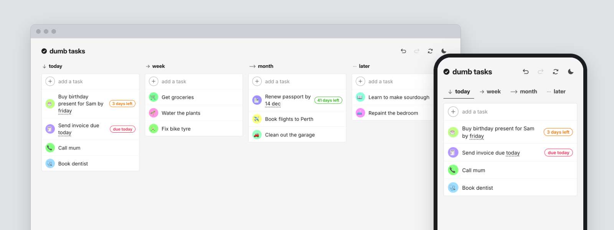

# Dumb Tasks

A really simple local-first task list. Sync with WebDAV or Google Drive.

Live at [dumbtasks.app](https://dumbtasks.app) or [self host your own](#self-host-with-docker).

<a href="https://dumbtasks.app">
  <picture>
    <source media="(prefers-color-scheme: dark)" srcset="docs/preview-dark.png" />
    
  </picture>
</a>

## Self-host with Docker

The Docker image serves the app with nginx. The self-hosted image syncs with WebDAV only. For
Google Drive sync, [self-host on Cloudflare](#self-host-on-cloudflare).

### Start the app

1. Get the code:

   ```bash
   git clone https://github.com/echus/dumb-tasks.git
   cd dumb-tasks
   ```

2. Build and start the container:

   ```bash
   docker compose up -d --build
   ```

3. Open `http://localhost:8080`.
4. Put the app behind a reverse proxy with https.

NOTE: Browsers can install the app and use it offline only on https or on localhost.

### Show the version

To show the commit in the sync menu, build with this command:

```bash
COMMIT_SHA=$(git rev-parse --short HEAD) docker compose up -d --build
```

### Update the app

1. Get the new code: `git pull`.
2. Build and start the container again: `docker compose up -d --build`.

Installed apps get the new version the next time they open.

## Self-host on Cloudflare

A Cloudflare Worker serves the app and the sign-in helper for Google Drive sync. The free plan
is enough.

1. Fork this repository.
2. In Google Cloud, make an OAuth client:
   - Turn on the Google Drive API.
   - On the OAuth consent screen, add the `drive.appdata` scope. Publish the app. In *Testing*,
     Google stops the sign-in after 7 days.
   - Make a client of type *Web application*. Add the address of your app to its JavaScript
     origins.
3. In `wrangler.jsonc`, change `routes` to your domain, or remove `routes` to use a
   `workers.dev` address.
4. In Cloudflare, make a Worker from your fork with Workers Builds. Set `VITE_GOOGLE_CLIENT_ID`
   as a build variable and `GOOGLE_CLIENT_SECRET` as a secret.
5. Push to `main`. Each push deploys the app again.

## Set up WebDAV sync

The browser connects directly to your WebDAV server. Thus, the server must allow the origin of
the app (CORS). The origin is the scheme and host of the app address, for example
`https://tasks.example.com`.

### Nextcloud

1. Install the [WebAppPassword](https://apps.nextcloud.com/apps/webapppassword) app.
2. In the admin settings of WebAppPassword, add the app origin to the WebDAV/CalDAV origins.
3. In *Personal settings → Security*, make an app password.
4. In the Files app, open *Files settings*. Copy the WebDAV address, for example
   `https://cloud.example.com/remote.php/dav/files/you/`.

### Apache

1. Enable `mod_dav`, `mod_dav_fs`, `mod_auth_basic` and `mod_headers`.
2. Set the lock database in the server configuration, outside all `<Directory>` sections.
   Without it, Apache cannot save files. Debian and Ubuntu set it when you enable `mod_dav_fs`.

   ```apache
   DavLockDB /var/lib/apache2/dav/lockdb
   ```

   Apache must have write access to the folder of the lock database.
3. Add this configuration to the `<Directory>` of the shared folder. Change the origin to the
   app origin.

   ```apache
   Dav On
   AuthType Basic
   AuthName "WebDAV"
   AuthUserFile /path/to/htpasswd
   # Browsers send the CORS check (OPTIONS) without a password
   <LimitExcept OPTIONS>
       Require valid-user
   </LimitExcept>
   # "always" also sends the headers with errors, for example a wrong password
   Header always set Access-Control-Allow-Origin "https://tasks.example.com"
   Header always set Access-Control-Allow-Methods "GET, PUT, DELETE, PROPFIND, MKCOL, OPTIONS"
   Header always set Access-Control-Allow-Headers "Authorization, Content-Type, Depth"
   Header always set Access-Control-Max-Age "86400"
   ```

4. Restart Apache.

### Other WebDAV servers

The server must:

- Answer `OPTIONS` requests without a password.
- Send the four `Access-Control-*` headers above with all responses, also with errors.

### Connect the app

1. In the app, open the sync menu.
2. Select *WebDAV*, then *Connect WebDAV*.
3. Enter the folder address, your username and your password. On Nextcloud, use the app password.
4. Select *Connect*.

The app keeps one file for each device in a `dumb-tasks` folder at that address.

## Development

```bash
npm install
npm run dev            # http://localhost:5173
npm test
npm run test:servers   # WebDAV sync against Apache and Nextcloud, in Docker
npm run test:browser   # the production build in Chrome, with the same servers
npm run check          # type check
npm run build
```

The service worker runs only in production builds: `npm run build && npm run preview`.

`npm run test:servers` and `npm run test:browser` need Docker and the internet (for the
Nextcloud WebAppPassword app). They set up each server as this README says, and take about a
minute the first time. To keep the servers running between runs, set `KEEP_SERVERS=1`.

`npm run test:browser` also needs Playwright's Chrome. Install it one time with
`npx playwright install chromium`. The browser tests do not cover Google Drive, as its sign-in
needs a real Google account. Before a release, test Google Drive sync on staging.

To test WebDAV sync, use a WebDAV server that allows the origin `http://localhost:5173`. The app
accepts `http` for a server on this computer.

### Google Drive and Cloudflare

- Setup and deploy: see [Self-host on Cloudflare](#self-host-on-cloudflare).
- Local: `VITE_GOOGLE_CLIENT_ID` in `.env.local`, `GOOGLE_CLIENT_SECRET` in `.dev.vars`. Add
  `http://localhost:5173` to the client's JavaScript origins.
- Staging: each push to a branch other than `main` deploys to `staging.dumbtasks.app`, the
  Preview named `staging`. `wrangler.jsonc` has the Preview command for Workers Builds. Set the
  Preview's `GOOGLE_CLIENT_SECRET` separately.

## Layout

Code outside `src/lib/` imports it as `$lib/...`.

- `src/lib/types.ts`: the data model (`Task`, `DataFile`)
- `src/lib/db.ts`: IndexedDB tables
- `src/lib/config.ts`: the build settings (the Google client, which turns on Drive sync)
- `src/lib/startup.ts`: Android share target, persistent storage
- `src/lib/tasks/`: the task list itself
  - `tasks.ts`: every task operation (add, move, complete, edit, delete)
  - `demo-tasks.ts`: the tasks shown on a first visit
  - `history.svelte.ts`: undo / redo
  - `deadline.ts`: finds deadlines in task text ("by friday", "14 nov")
  - `guess-icon.ts`: picks an icon from keywords
  - `circle-colours.ts`: the fallback emoji, and each task's circle colour
  - `recolour.ts`: brings older tasks up to the current icon and colour rules
- `src/lib/sync/`: backup and sync
  - `merge.ts`: per-field merge for backup import and sync
  - `data-file.ts`: JSON export / import
  - `engine.ts`: pull, merge, push against any `SyncBackend`
  - `local-changes.ts`: tells sync a task was written
  - `drive.ts`, `google-auth.ts`: the Google Drive backend and sign-in
  - `webdav.ts`: the WebDAV backend
  - `device-files.ts`: what both backends do alike with the device files
  - `settings.ts`: what this device keeps about syncing (service, sign-in, progress)
  - `sync.svelte.ts`: when to sync, connecting each service, and the state the sync menu shows
- `src/lib/ui/`: the parts of the UI that are not components
  - `drag-and-drop.ts`: dragging a task, from press to drop, with `drag-layout.ts` (where it
    lands), `drag-preview.ts` (the copy under the pointer) and `drag-scroll.ts`
  - `caret.ts`: puts the caret where a task's text was clicked
  - `state.svelte.ts`, `theme.svelte.ts`, `icons.ts`: shared UI state, theme, icons
- `src/components/`: the UI (Svelte 5)
  - `sync-menu/`: the sections of the sync and backup menu (`SyncMenu.svelte`)
- `worker/index.ts`: the sign-in Worker, which keeps people signed in to Drive
- `Dockerfile`, `docker-compose.yml`, `docker/nginx.conf`: the self-hosted image (WebDAV only)
- `tests/`: the tests, in the same layout as `src/`
  - `helpers/`: fake servers, fake Google sign-in, and tabs of the app on one device
  - `servers/`: the WebDAV servers for `npm run test:servers` and `npm run test:browser`
  - `browser/`: the tests for `npm run test:browser`: tasks, offline, drag and drop, sync

## Feedback

Open an issue on GitHub, or send an email to contact@dumbtasks.app.

If you like the app, [buy me a nap on Ko-fi](https://ko-fi.com/echus) 😴

## License

Copyright © 2026 Varvara Efremova, under the [AGPL-3.0](LICENSE). The license does not cover the
name "Dumb Tasks" or the app icon. Use a different name and icon for a fork.
